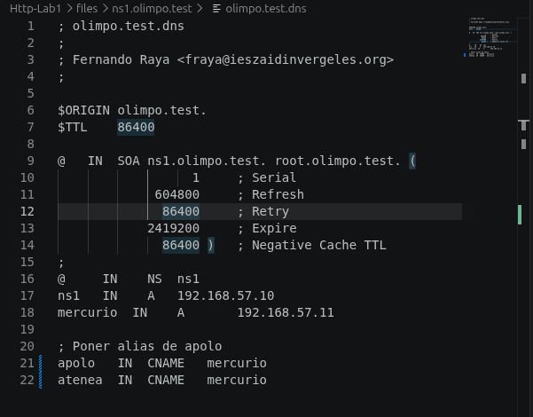
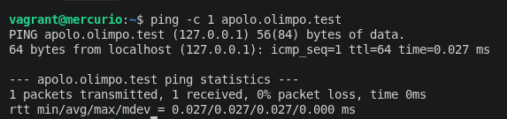
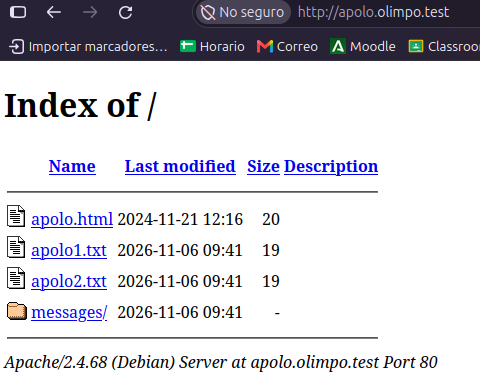
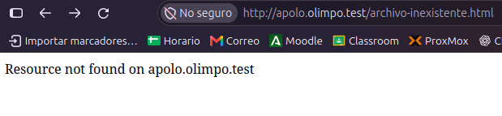
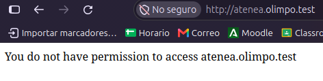
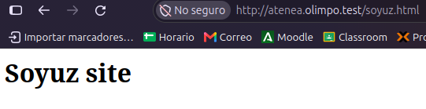
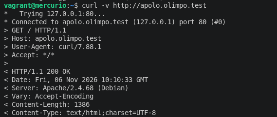
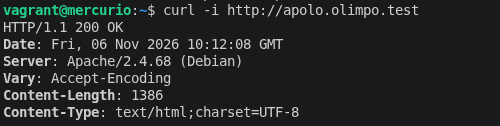
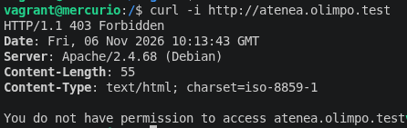
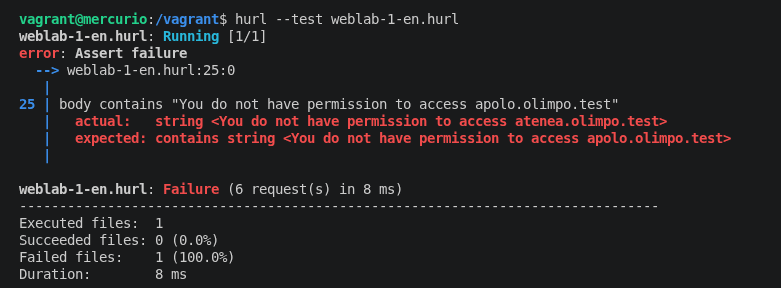

# HTTP Lab 1: Virtual Hosts with Apache

This repository contains the configuration, automation scripts, and documentation for **HTTP Lab 1: Virtual Hosts**. Two independent virtual hosts (`apolo.olimpo.test` and `atenea.olimpo.test`) were configured on an Apache web server running within a Vagrant-managed virtual machine.

---

## 1. DNS Configuration and Name Resolution

CNAME aliases pointing to the server host `mercurio.olimpo.test` were registered to enable access via domain names rather than IP addresses.

* **CNAME Aliases:** `apolo.olimpo.test` and `atenea.olimpo.test` pointing to `mercurio.olimpo.test`.

### Resolution Verification
Local domain resolution was verified using the `ping` command:

---

## 2. Apache Virtual Hosts Configuration

Two separate site configuration files were created in `/etc/apache2/sites-available/`:

### Apolo (`apolo.olimpo.test.conf`)
- **Document Root:** `/var/www/apolo.olimpo.test`
- **Directory Indexing:** Enabled (`Options +Indexes`)
- **Custom Error Pages:**
  - `403 Forbidden`: Displays `"You do not have permission to access apolo.olimpo.test"`
  - `404 Not Found`: Redirects to `/messages/404.html`

### Atenea (`atenea.olimpo.test.conf`)
- **Document Root:** `/var/www/atenea.olimpo.test`
- **Directory Indexing:** Disabled (`Options -Indexes`)
- **Custom Error Pages:**
  - `403 Forbidden`: Displays `"You do not have permission to access atenea.olimpo.test"`
  - `404 Not Found`: Redirects to `/messages/404.html`

---

## 3. Web Browser Verification

Virtual host behaviors were verified by accessing the domains through a web browser:

### Apolo - Directory Listing (`+Indexes`)
Since no `index.html` file exists in the root directory of `apolo.olimpo.test`, Apache automatically generates a directory index.

### Apolo - Custom 404 Error Page
When requesting a non-existent resource (`/index.html`), Apache serves the custom page defined at `/messages/404.html`.

### Atenea - 403 Forbidden Access Control (`-Indexes`)
Attempting to list the root directory of `atenea.olimpo.test` with indexing disabled causes Apache to block access and display the custom 403 message.

### Atenea - Existing Resource Access (`soyuz.html`)
Requesting `http://atenea.olimpo.test/soyuz.html` successfully serves the page with an HTTP `200 OK` status code.

---

## 4. Command Line Verification (`curl`)

HTTP headers and responses were validated directly in the terminal:

* **Apolo Directory Listing:** `curl -i http://apolo.olimpo.test`
  

* **Custom 404 Response:** `curl -i http://apolo.olimpo.test/index.html`
  

* **Atenea 403 Error:** `curl -i http://atenea.olimpo.test`
  

---

## 5. Automated Test Suite (`hurl`)

The HTTP test suite in `weblab-1-en.hurl` was executed using **Hurl**, successfully passing 6 / 8 of the status code and response body assertions.

